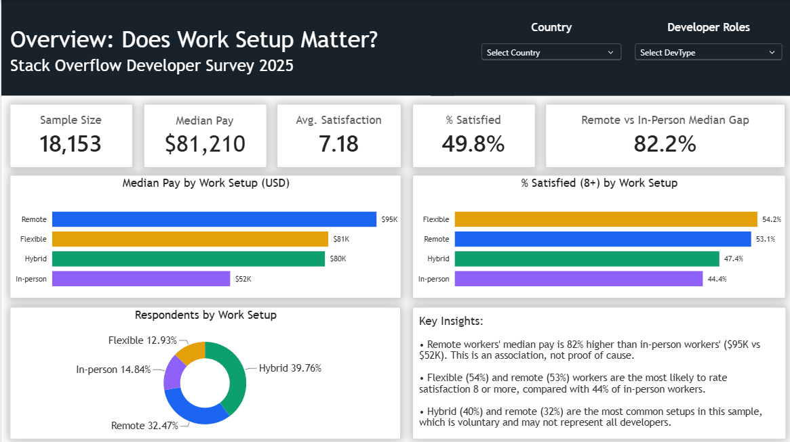
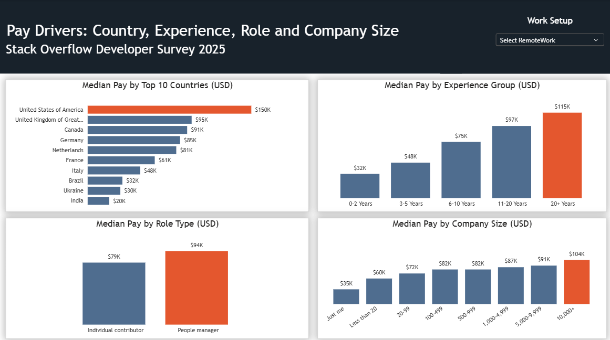
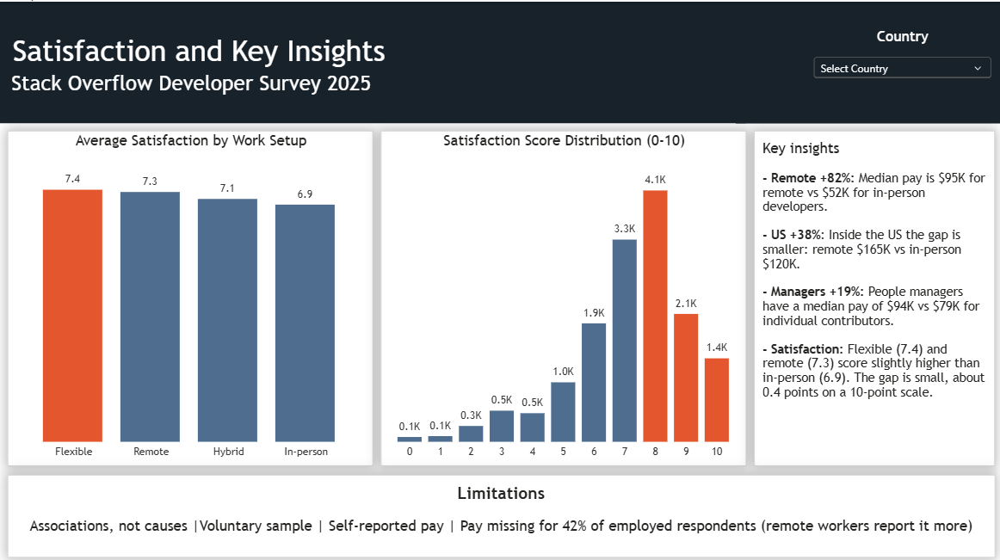

# 📊 Statistical Analysis of Developer Pay and Job Satisfaction

**Does work setup (remote, hybrid, flexible, in-person) link to developer pay and job satisfaction, and how much of that link is really country, experience, role or company size? Analysis of 18,153 developers from the Stack Overflow Developer Survey 2025, built with Python (pandas, scipy, seaborn), SQL Server and Power BI.**

📓 [View Notebook](https://github.com/SahilBhowad/statistical-analysis-developer-pay-job-satisfaction/blob/main/notebook/statistical_analysis_developer_pay_jobsat.ipynb) | 🗄️ [View SQL Queries](https://github.com/SahilBhowad/statistical-analysis-developer-pay-job-satisfaction/blob/main/sql/so_survey_queries.sql) | 📊 [View Dashboard](https://github.com/SahilBhowad/statistical-analysis-developer-pay-job-satisfaction/tree/main/Images) | 📥 [Download Power BI File (.pbix)](https://github.com/SahilBhowad/statistical-analysis-developer-pay-job-satisfaction/blob/main/dashboard/Statistical%20Analysis%20Developer%20Pay%20%26%20Jobsat.pbix) | 🐍 Python + SQL + Power BI | 👨‍💻 18,153 Developers Analyzed

---

## 📌 The Business Problem

Imagine the HR team of a tech company deciding whether to allow remote work, how to set pay, and how to keep people happy. Their question:

> **What is linked to higher pay and higher job satisfaction among tech workers?**

**Data:** Stack Overflow Developer Survey 2025, 49,191 respondents and 173 columns. After cleaning, the final sample is **18,153 employed developers** with a realistic yearly pay, using 16 relevant columns. Source: [survey results file](https://media.githubusercontent.com/media/StackExchange/Survey/refs/heads/main/packages/archive/2025/results.csv). The raw file is too large for GitHub, so download it from that link.

---



---

## 💡 Key Results

* Remote developers have about **82% higher median pay** than in-person developers ($95,132 vs $52,207).
* Part of that gap is *where people live*. Inside the United States only, the gap is about **38%** ($165,000 vs $120,000).
* People managers earn about **19% more** (median) than individual contributors ($93,611 vs $78,890).
* Flexible and remote developers are slightly more satisfied, but the difference is small.
* Experience is linked to pay (r = 0.37) but hardly to satisfaction (r = 0.08).

---

## 🛠️ Tools & Approach

| Stage | What I did |
|---|---|
| Selection | Chose 16 of 173 columns that connect to the question |
| Cleaning | Kept employed people with realistic pay, counted every row removed |
| Sample check | Checked if the sample is fair (42% of employed people did not report pay) |
| Statistics | ANOVA, t-test + confidence interval, chi-square, correlation |
| SQL layer | 11 queries in SQL Server that reproduce the Python numbers |
| Dashboard | 3-page Power BI report |

**Cleaning funnel**

| Step | People left |
|---|---|
| All respondents | 49,191 |
| Employed only | 33,750 |
| Gave their pay | 19,500 |
| Pay between $1,000 and $500,000 (removed typing mistakes) | 18,953 |
| No missing values in key columns | **18,153** |

<details>
<summary><b>📋 Full workflow: what I did, step by step (click to expand)</b></summary>

1. **Looked at the raw file** and chose the 16 useful columns. Most of the 173 columns are about tools, AI and Stack Overflow habits, so I kept only the ones that connect to my question.
2. **Checked the missing values.** Pay and satisfaction had a lot of blanks. I did not fill them with made-up values.
3. **Cleaned the data and counted every step** (see the funnel above).
4. **Made the labels shorter**, for example "20 to 99 employees" became "20-99", and the long "Hybrid (some remote, leans heavy to in-person)" became "Hybrid".
5. **Checked if the sample is fair.** About 42% of employed people did not give their pay, and remote workers gave it more often. So my results describe developers who report their pay.
6. **Explored the data with charts** (pay, satisfaction, country, experience, company size).
7. **Tested five questions with statistics** (see Findings).
8. **Repeated the key numbers in SQL**, then **built a 3-page Power BI dashboard**.

</details>

<details>
<summary><b>📖 The statistics in simple words (click to expand)</b></summary>

* **Median:** the middle value. I used it instead of the average, because a few very high salaries pull the average up.
* **Log of pay:** pay is skewed (a few huge salaries). Taking the log makes it closer to a bell curve, so t-tests and ANOVA work better. A difference in log pay can be turned back into a % difference.
* **p-value:** the chance of seeing such a difference just by luck. Below 0.05 means it is probably not luck.
* **ANOVA:** checks if the averages of 3 or more groups are really different.
* **t-test:** the same idea for 2 groups.
* **Confidence interval:** a range where the true difference probably lies. If it does not include 0%, the difference is unlikely to be luck.
* **Chi-square test:** checks if two category columns are related (here: work setup and being satisfied).
* **Correlation (r):** a number from -1 to +1 that shows how two numbers move together. r squared tells how much of the difference is explained.
* **Stricter alpha:** when I compare several groups, I divide 0.05 by the number of comparisons, so I do not get false alarms.

With thousands of people, even small differences look "significant". So I always looked at **how big** the difference is, not only at the p-value.

</details>

---

## 🔎 Findings

| # | Question | Method | Finding | Takeaway |
|---|---|---|---|---|
| 1 | Does pay change with work setup? | ANOVA | **Yes.** Median pay: Remote $95,132, Flexible $80,984, Hybrid $80,000, In-person $52,207 | Compare pay within the same country, not across the whole sample |
| 2 | Do managers earn more than individual contributors? | t-test + confidence interval | **Yes.** About 16% more on average (11.5% to 21.2%); 19% by median | Management track carries a clear pay premium |
| 3 | Does satisfaction change with work setup? | ANOVA + chi-square | **A little.** Flexible 7.36, Remote 7.30, Hybrid 7.09, In-person 6.93. 53.1% of remote vs 44.4% of in-person rate 8 or more | Flexibility helps satisfaction slightly, but it is not a big lever |
| 4 | Is experience linked to pay and satisfaction? | Correlation | **Pay: yes** (r = 0.37, explains about 14%). **Satisfaction: almost none** (r = 0.08) | Experience raises pay, not happiness |
| 5 | Does work setup matter inside one country? | ANOVA (US only) | **Yes, but smaller:** Remote $165,000 vs In-person $120,000 (about 38%) | Part of the remote pay gap is geography |

*Why 16% and 19% for managers? One compares averages of log pay, the other compares medians.*

With thousands of people, even small differences look "significant", so I checked **how big** each difference is, not only the p-value.

---

## 🗄️ SQL Highlight

I loaded the clean data into SQL Server (table `dev_survey`). Medians use `PERCENTILE_CONT` with window functions, and each query has a short insight line. Queries cover respondents and median pay by work setup, satisfaction by work setup, median pay by role, country, experience and company size, and the US-only work-setup comparison.

```sql
-- Paste your best query here (for example, median pay by work setup using PERCENTILE_CONT)
```

Full file: `sql/so_survey_queries.sql`

---

## 📊 Power BI Dashboard

| Page | Shows |
|---|---|
| 1. Overview | Does work setup matter? |
| 2. Pay Drivers | Country, experience, role, company size |
| 3. Satisfaction | Satisfaction and key insights |




Tip: choose a country in the filter to see how the work-setup gap changes.

---

## ⚠️ Limitations & Next Steps

**Limitations**

* The survey shows links, not causes.
* People chose to answer and are mostly Stack Overflow users, so results do not represent all developers.
* Pay is self-reported and can contain mistakes.
* About 42% of employed respondents did not report pay, and remote workers reported it more often.
* The US test does not control for experience, role or company size.

**Next Steps**

* Build a regression model that controls for country, experience, role and company size together.
* Repeat the analysis on another survey year to see if the patterns hold.

---

## 🎓 What I Learned

* How to clean messy survey data and count every row I remove.
* Why the median is better than the average when pay is skewed.
* How to pick the right test (ANOVA, t-test, chi-square, correlation) and explain it simply.
* That a small p-value does not mean a big or important difference.
* That the same numbers should match in Python, SQL and Power BI, so I checked them in all three.

---

## 📁 Repo Structure

```
statistical-analysis-developer-pay-job-satisfaction/
├── README.md
├── Data/
│   ├── Original/       raw survey file (large, download link in How to Run)
│   ├── Selected/       the 16 selected columns
│   └── Cleaned/        clean data used for SQL and Power BI
├── notebook/
│   └── statistical_analysis_developer_pay_jobsat.ipynb
├── sql/
│   └── so_survey_queries.sql
├── dashboard/
│   └── Statistical Analysis Developer Pay & Jobsat.pbix
└── Images/             charts and dashboard screenshots
```

## 🚀 How to Run

1. Download the [2025 survey file](https://media.githubusercontent.com/media/StackExchange/Survey/refs/heads/main/packages/archive/2025/results.csv) and save it as `Data/Original/so_survey_2025.csv`.
2. `pip install pandas numpy matplotlib seaborn scipy jupyter`
3. Run the notebook. It creates the selected and cleaned files.
4. SQL: import the clean CSV into SQL Server as `dev_survey` (SSMS Import Flat File), then run the queries.
5. Power BI: open the `.pbix` file in Power BI Desktop (free).

> The code is written for the 2025 survey. Other years may use different column names or labels (for example in `Employment` and `RemoteWork`).

The survey data belongs to Stack Overflow and is used under its own terms. The MIT License covers my code and analysis only.

---

**Sahil Bhowad** | Aspiring Data Analyst | Mumbai | [LinkedIn](https://www.linkedin.com/in/sahil-bhowad-7a915934a/) | [GitHub](https://github.com/SahilBhowad)
