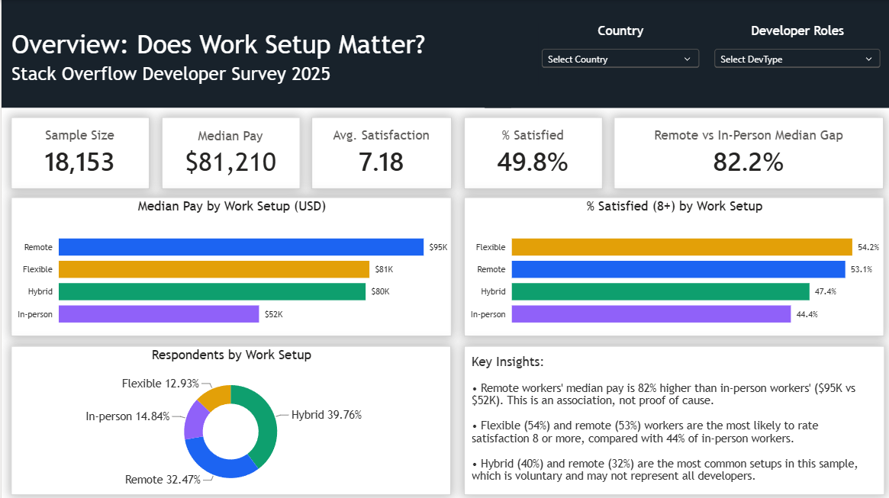
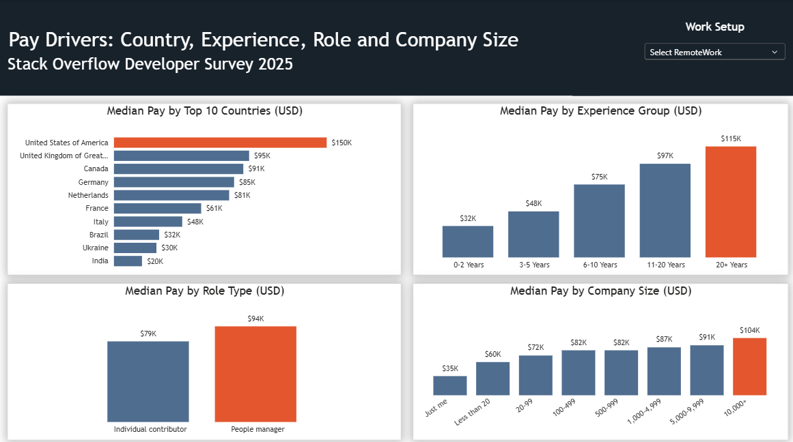
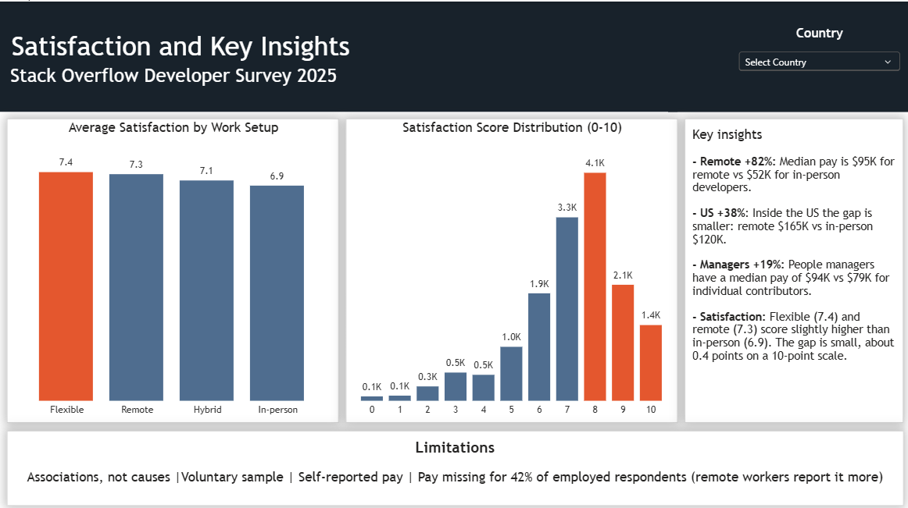

# 📊 Statistical Analysis of Developer Pay and Job Satisfaction

**End-to-end analytics project investigating whether work setup (remote, hybrid, flexible, in-person) is linked to developer pay and job satisfaction in the Stack Overflow Developer Survey 2025 — and how much of that link comes from country, experience, role and company size. Built with Python (pandas, scipy, seaborn), SQL Server (SSMS) and Power BI.**

📓 [View Notebook](https://github.com/SahilBhowad/statistical-analysis-developer-pay-job-satisfaction/blob/main/notebook/statistical_analysis_developer_pay_jobsat.ipynb) | 🗄️ [View SQL Queries](https://github.com/SahilBhowad/statistical-analysis-developer-pay-job-satisfaction/blob/main/sql/so_survey_queries.sql) | 📊 [View Dashboard](https://github.com/SahilBhowad/statistical-analysis-developer-pay-job-satisfaction/tree/main/Images) | 📥 [Download Power BI File (.pbix)](https://github.com/SahilBhowad/statistical-analysis-developer-pay-job-satisfaction/blob/main/dashboard/Statistical%20Analysis%20Developer%20Pay%20%26%20Jobsat.pbix) | 🐍 Python + SQL + Power BI | 👨‍💻 18,153 Developers Analyzed

---

## The story in short

Imagine the HR team of a tech company. They have to decide three things: should we allow remote work, how should we set pay, and how do we keep people happy? Their question is simple:

> **What is linked to higher pay and higher job satisfaction among tech workers?**

**The short answer from the data:**

* Remote developers have a much higher median pay than in-person developers (about **82% higher**, $95,132 vs $52,207).
* Part of that gap comes from *where people live*. Inside the United States alone, the gap is smaller (about **38%**, $165,000 vs $120,000).
* People managers earn more than individual contributors.
* Flexible and remote developers are a little more satisfied, but the difference is small.
* Experience is linked to pay, but not really to satisfaction.
* These are just patterns, not proof—working remotely doesn't automatically mean higher pay.

---

## About the data

| | |
|---|---|
| **Source** | Stack Overflow Developer Survey 2025 ([so_survey_2025.csv](https://media.githubusercontent.com/media/StackExchange/Survey/refs/heads/main/packages/archive/2025/results.csv)) |
| **Size** | 49,191 respondents and 173 columns (questions) |
| **Columns I used** | 16 columns about pay, satisfaction, experience, work setup, role, country and tools |
| **Final sample** | 18,153 employed developers with a realistic yearly pay |

Most of the 173 columns are about tools, AI and Stack Overflow habits, so I only kept the 16 that connect to my question. The raw file is big, so it is **not** uploaded here. You can download it from the survey website.

The survey data belongs to Stack Overflow and is used under its own terms. The MIT License covers my code and analysis only.

---

## What I did, step by step

1. **Looked at the raw file** and chose the 16 useful columns.
2. **Checked the missing values.** Pay and satisfaction had a lot of blanks. I did not fill them with made-up values.
3. **Cleaned the data and counted every step:**

| Step | People left |
|---|---|
| All respondents | 49,191 |
| Only employed people | 33,750 |
| Only people who gave their pay | 19,500 |
| Pay between $1,000 and $500,000 (removed typing mistakes) | 18,953 |
| Removed rows with missing values in key columns | **18,153** |

4. **Made the labels shorter**, for example "20 to 99 employees" became "20-99", and the long "Hybrid (some remote, leans heavy to in-person)" became "Hybrid".
5. **Checked if the sample is fair.** About 42% of employed people did not give their pay, and remote workers gave it more often (32.2% vs 20.4%). So my results describe developers who report their pay.
6. **Explored the data with charts** (pay, satisfaction, country, experience, company size).
7. **Tested five questions with statistics** (below).
8. **Repeated the key numbers in SQL**, then **built a 3-page Power BI dashboard**.

---

## The five questions and my answers

| # | Question | What I used | Answer |
|---|---|---|---|
| 1 | Does pay change with work setup? | ANOVA | **Yes.** Median pay: Remote $95,132, Flexible $80,984, Hybrid $80,000, In-person $52,207. All three are higher than In-person. |
| 2 | Do managers earn more than individual contributors? | t-test and confidence interval | **Yes.** About 16% more on average (between 11.5% and 21.2%). By median it is $93,611 vs $78,890, about 19%. |
| 3 | Does satisfaction change with work setup? | ANOVA and chi-square | **A little.** Average score: Flexible 7.36, Remote 7.30, Hybrid 7.09, In-person 6.93. 53.1% of remote and 44.4% of in-person workers rate 8 or more. |
| 4 | Is experience linked to pay and satisfaction? | Correlation | **Pay: yes** (r = 0.37, explains about 14%). **Satisfaction: almost none** (r = 0.08). |
| 5 | Does work setup still matter inside one country? | ANOVA (United States only) | **Yes, but the gap is smaller.** Remote $165,000 vs In-person $120,000 (about 38%). |

*Why two numbers for managers (16% and 19%)? One compares averages (of log pay) and the other compares the middle values (medians), so they are a little different.*

---

## The statistics in simple words

* **Median:** the middle value. I used it instead of the average, because a few very high salaries pull the average up.
* **Log of pay:** pay is skewed (a few huge salaries). Taking the log makes it closer to a bell curve, so t-tests and ANOVA work better. A difference in log pay can be turned back into a % difference.
* **p-value:** the chance of seeing such a difference just by luck. Below 0.05 means it is probably not luck.
* **ANOVA:** checks if the averages of 3 or more groups are really different.
* **t-test:** the same idea for 2 groups.
* **Confidence interval:** a range where the true difference probably lies. If it does not include 0%, the difference is unlikely to be luck.
* **Chi-square test:** checks if two category columns are related (here: work setup and being satisfied).
* **Correlation (r):** a number from -1 to +1 that shows how two numbers move together. r squared tells how much of the difference is explained.
* **Stricter alpha:** when I compare several groups, I divide 0.05 by the number of comparisons, so I do not get false alarms.

With thousands of people, even small differences look "significant". So I always looked at **how big** the difference is, not only at the p-value.

---

## SQL part

I loaded the clean data into SQL Server (table `dev_survey`) and wrote 11 queries. They give the same numbers as Python, for example:

* total respondents (18,153) and the KPI numbers
* respondents and median pay by work setup
* average satisfaction and % satisfied by work setup
* median pay by role, country, experience group and company size
* median pay by work setup inside the United States

Each query has a short insight line under it. The medians use `PERCENTILE_CONT` with window functions. File: `sql/so_survey_queries.sql`

---

## Power BI dashboard

A 3-page dashboard. Page 1 gives the answer, page 2 shows what drives pay, and page 3 shows satisfaction and the key insights.

**Page 1: Overview, does work setup matter?**



**Page 2: Pay drivers (country, experience, role, company size)**



**Page 3: Satisfaction and key insights**



Tip: choose a country in the filter to see how the work-setup gap changes.

---

## Things to keep in mind

* The survey shows **links, not causes**.
* People chose to answer, mostly Stack Overflow users, so it does not represent all developers.
* Pay is self-reported and can have mistakes.
* About 42% of employed respondents did not report pay, and remote workers reported it more often.
* In the US test, I did not control for experience, role or company size.

---

## Tools

Python (pandas, numpy, matplotlib, seaborn, scipy) | SQL Server (SSMS) | Power BI | Jupyter Notebook

---

## Folder structure

```
statistical-analysis-developer-pay-job-satisfaction/
├── README.md
├── Data/
│   ├── Original/       raw survey file (not uploaded)
│   ├── Selected/       the 16 selected columns
│   └── Cleaned/        clean data used for SQL and Power BI
├── notebook/
│   └── statistical_analysis_developer_pay_jobsat.ipynb
├── sql/
│   └── so_survey_queries.sql
├── dashboard/
│   └── Statistical Analysis Developer Pay & Jobsat.pbix
└── Images/             charts and dashboard screenshots
```

---

## How to run it

1. Download the 2025 survey file from [direct download link, large file](https://media.githubusercontent.com/media/StackExchange/Survey/refs/heads/main/packages/archive/2025/results.csv) and save it as `Data/Original/so_survey_2025.csv`.
2. Install the libraries: `pip install pandas numpy matplotlib seaborn scipy jupyter`
3. Open the notebook and run all cells. It creates the selected and cleaned files.
4. SQL: import the clean CSV into SQL Server as `dev_survey` (SSMS Import Flat File), then run the queries.
5. Power BI: open the `.pbix` file with Power BI Desktop (free).

---

## What I learned

* How to clean messy survey data and count every row I remove.
* Why the median is better than the average when pay is skewed.
* How to pick the right test (ANOVA, t-test, chi-square, correlation) and explain it simply.
* That a small p-value does not mean a big or important difference.
* That the same numbers should match in Python, SQL and Power BI, so I checked them in all three.

---

## About me

**Sahil Bhowad** | Aspiring Data Analyst | Mumbai
[LinkedIn](https://www.linkedin.com/in/sahil-bhowad-7a915934a/) | [GitHub](https://github.com/SahilBhowad)

---

> **Note:** The code is written for the 2025 survey. Other years may use different column names or answer labels (for example in `Employment` and `RemoteWork`), so check them before running.
